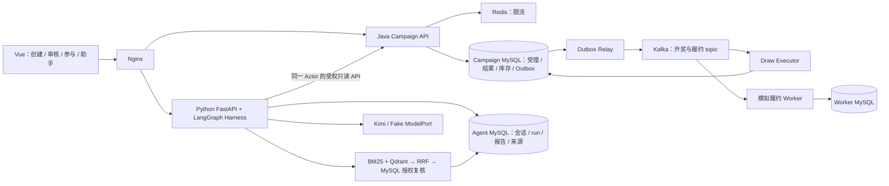

# PrizeFlux 双项目竞争力增强方案

日期：2026-09-28。本轮交付：代码与证据复核后的架构/执行方案；尚未实施新增能力。

本方案承接 [产品架构](product-agent-blueprint.md) 与 [P0–P15 交付计划](product-delivery-plan.md)，细化其尚未闭环的能力，不重新建立产品或恢复旧 64 项。当前事实以 [PROJECT_STATUS](../../PROJECT_STATUS.md) 为准；下一批执行入口为 [增强任务清单](../../tasks/competitiveness-enhancement-tasks.md)。历史文档中的 Java Harness、Fake-only、内存会话描述不能覆盖当前 Python 实现。

## 1. 定位、假设与完成标准

岗位定位暂按校招/初级 Java 后端与 AI Agent 应用工程。用户尚未提供具体 JD，这不是对录用概率的承诺，也不覆盖模型训练/算法研究岗位。

- **PrizeFlux 抽奖平台**：展示高峰请求下的事务一致性、受控排队、重复消息处理、故障恢复及可复现性能实验。
- **PrizeFlux Copilot**：展示结合实时业务数据与规则知识的活动预检助手，重点是工具授权、结构化报告、受控 RAG、运行状态与效果评测。
- 两个条目属于同一产品；Java 与 Python 各自有构建入口、数据权限、测试与演示材料，仍使用当前单仓库。通过 HTTP 合作，不为简历数量拆仓库或复制功能。
- 产品默认本机 Compose；公网部署、私有仓库可见性、真实奖品供应商和新的外部费用仍由用户决定。完成本机发布候选可以形成项目证据，无须先购买服务器。
- 竞争力完成标准是能展示一个用户任务、解释关键取舍、复现故障与实验，并指出已知限制。代码量、框架数量和测试数量不独立构成通过标准。用户学习与 L1–L4 验收在构建之后单独进行。

用户能感知的主流程：创建者填写草案 → 查看字段问题与规则依据 → 手动修改 → Java 再校验并提交审核 → 运营审核 → 参与者即时/排队抽奖。Agent 不保存草案、不审批、不开奖。

## 2. 复核结果：哪些复用，哪些补齐

| 现有证据/源码 | 复核结论 | 对方案的影响 |
|---|---|---|
| Java 事务、条件库存更新、幂等请求、Outbox；Kafka 故障/rebalance 记录 | 已有正确性与本机恢复证据，值得保留 | 在原交易协议上做测量与局部优化 |
| `scripts/smoke-draw-worker-cross-process.ps1` 的队列 benchmark | PowerShell runspace 批次调度；批次时间含客户端调度；请求延迟含客户端 JSON 处理；先完成受理/Outbox 发布再启动消费者 | 约 95 次/秒是该场景观察值，既不是纯服务吞吐，也不是已证明的容量上限 |
| `docs/baseline/draw-queue-load-500-100-20-users-2026-09-28.json` | 受理 5.26s、等待 Outbox 发布 52.69s、消费者启动后排空与模拟履约 42.63s，包含阶段性等待；只有单轮 | 各阶段分开报告，不能把总耗时直接当正常线上每请求等待时间 |
| `DrawQueueApplicationService.enqueue` / `JdbcDrawQueueRepository.pressureSnapshot` | 每次新请求先查幂等，再限流、执行积压 COUNT/MIN、检查容量、事务受理 | 积压查询代价是待测假设；连接池拒绝是保护触发证据，不等于已定位根因 |
| `OutboxPublisher.publishDue` / `KafkaEventPublisher.publish` | 当前逐事件同步等 Kafka 发送确认，再标记 SENT | Relay 确认等待是可测优化候选，先分解时延再决定是否引入有界并发 |
| `JdbcDrawRepository.lockPublishedConfig` | 配置使用 FOR SHARE；库存/配额仍由条件写入保护 | 不误判为活动行排他锁，不为速度取消关闭/发布与抽奖的正确性协议 |
| Python `CampaignReadSummaryTool` | 业务摘要只返回 campaignId/name/status | 当前产品价值偏窄；需要有权限的草案/配置/审核理由上下文 |
| Python `CreateAgentRunRequest` | 持久 run 入口只有 clientMessageId/expectedVersion/input；已有草案类型与校验工具未构成完整 Creator run 流程 | 增补结构化输入、指纹与报告持久化，复用现有工具和 RunStore |
| Python P9–P12 | 已有索引版本、BM25+dense/RRF、ACL/撤回、metadata 引用与 5 条离线案例；真实索引未启用 | 不从零重做 RAG；补真实构建、语料、引用支持性与端到端评测 |
| Kimi P13 | 工具名称适配后两轮 provider 协议 smoke 已通过；真实业务工具及页面链路未复测 | 首先闭环现有 provider，随后才跑效果实验 |
| Git 与简历资料 | 本地有大量未提交修改；历史远程 CI 不能证明当前工作树；旧简历页还以 Java 内存 Harness 为主 | 发布材料与代码证据同步，保持 private，记录实际 commit/dirty 状态 |

## 3. 增强模块及依赖

以下稳定 ID 是已有 P 任务的工作包索引，均为待执行；不替代原业务模块，也不表示已完成。

| ID | 职责 | 依赖 | 关联原计划 |
|---|---|---|---|
| evidence-baseline | 当前版本清单、Kimi/产品 E2E、测试与指标口径校准 | 已有产品 | P13/P14/P15 |
| draw-capacity | 分段观测、持续到达率实验、基于证据的局部优化、恢复验证 | evidence-baseline | P2/P14-F/P15 |
| creator-copilot | 草案/审核上下文、确定性预检、受控模型报告、Creator 页面 | evidence-baseline | P6/P8/P11/P13 |
| knowledge-quality | 维护语料、真实 Embedding/Qdrant 索引、权限与引用验证 | evidence-baseline | P9/P10/P11 |
| agent-evaluation | 冻结案例、规则基线、真实模型/检索对照、轨迹与费用 | creator-copilot + knowledge-quality | P12/P13 |
| release-evidence | 可复现发布候选、两份项目演示/说明、最终回归与交接 | 以上所有模块 | P14/P15 |

当前窗口串行执行顺序：evidence-baseline → creator-copilot 的离线闭环 → draw-capacity 的测量 → knowledge-quality → agent-evaluation → draw-capacity 的必要优化/对照 → release-evidence。可穿插无外部依赖工作，但不另开 Agent。

## 4. 架构保留与调整

- Java 仍拥有业务事实。Python 不读取 Campaign/Worker 数据库，不持有 JWT 签名密钥；实时事实从授权 HTTP 工具读取。
- LangGraph 承担状态流转，项目 Harness 承担授权、预算、证据与终态政策；MySQL RunStore 是唯一运行事实。暂不增加第二套 LangGraph checkpoint 持久化来复制同一状态。
- 会话沿用 MySQL，有界历史作为上下文。Redis 留在业务限流位置；没有测得记忆读瓶颈前不复制一套 Redis 会话缓存。
- Java AI 保持迁移回退用途。Python Creator 达到功能/权限对等并通过回归之后才从默认产品路径移除 legacy 服务；本轮不直接删源码。
- 不新增微服务治理平台、分库分表、多 Agent 团队或自动写工具。后续新增运营诊断聚合 API、真正先到先得秒杀、支付和真实发奖属于单独范围决策。

## 5. Java：从并发功能到可解释的容量与恢复

### 5.1 最小可观测性

在现有应用边界补 Micrometer/内部指标出口；Prometheus/Grafana 可作为本地可选 profile，不成为业务启动依赖。先用结构化日志与 JSON 报告完成实验也可。指标端点仅内部访问。

- HTTP：尝试、受理、429、容量 503、其他异常；受理时延与结果查询时延分开。
- MySQL：连接池 active/pending/timeout、获取连接时间、关键事务时间、锁等待；记录索引/执行计划和所用隔离级别。
- 队列：未终结数、最老年龄、接受到完成时延、恢复/人工处理数；终态分成功开奖与明确业务拒绝。
- Outbox：创建到确认时间、待发年龄、租约重领、发送失败；Kafka consumer lag 仅作传输指标，不能代替 DB 业务积压。
- Worker：完成/重试/人工处理/重复事件抑制。数据均注明模拟履约。
- requestId/queueRequestId/eventId 用于脱敏关联日志；不作为 Prometheus label，避免高基数。不得记录 Bearer、密码或用户请求正文。

### 5.2 两类实验分别保留

现有 PowerShell 脚本继续做故障与对账实验。新增 k6 到达率场景负责持续负载；官方文档说明 open model 将发起节奏与响应时长解耦，需同时检查 VU 不足导致的 dropped_iterations。[k6 负载模型](https://grafana.com/docs/k6/latest/using-k6/scenarios/concepts/open-vs-closed/) [到达率执行器](https://grafana.com/docs/k6/latest/using-k6/scenarios/executors/constant-arrival-rate/)

实验要求：

1. 使用随机隔离 schema/容器与合成账号，鉴权和数据准备不计入计时；固定库存、概率、用户配额及 ID 分布，记录负载生成器与服务是否同机。
2. 正常持续负载时 Relay、消费者、Worker 全部先启动并预热。预热 30 秒；25/50/100/200 请求每秒逐档探测，每档 60 秒；达到停止条件即停。选一个可稳定档做 5 分钟、3 次独立样本。更高档只有资源允许才测。
3. 分别测单热点活动/多个活动；1 个与 2 个 executor 的对照使用相同总资源预算或明确额外资源。单热点库存写仍可能串行，不能承诺扩容成倍增益。
4. 正常档与过载档分开：正常档期望符合资格的请求被接受；过载档允许明确的 429/503，但统计拒绝比例、已受理完成比例、恢复时间和查询可用性。不能通过大量拒绝获得好看的吞吐或低延迟。
5. 报告尝试率/实际发出率/受理率/终结率、P50/P95/P99、generator dropped、CPU/RAM、池/锁/队列指标。分母、失败、超时、未终结请求全部保留；无终态时不能丢样本计算时延。
6. 停止流入后在声明的清空窗口内对账：库存无负数、业务配额合法、唯一结果、Outbox 与中奖账本对应、无重复履约。性能通过与正确性通过分别判定。

停止条件预先写入场景配置：出现库存/幂等不变量破坏立即停止发压；非预期错误连续 30 秒超过 1%、最老未终结任务超过 60 秒或主机/容器内存持续 30 秒超过已分配预算的 85% 时停止升档并排空。预期的过载拒绝独立统计，不混入非预期错误。生成器 dropped>0 的档位标记负载未达成，先修生成器或降低声明负载，不能据此判服务器达标。120 秒观察结束仍有未终结项时保存失败快照/数据供诊断，不靠延长到无限等待或删除任务制造通过。

**初始工程目标（待实测，不是已有成绩）**：在记录资源的本机隔离环境尝试稳定 50 次排队提交/秒、持续 5 分钟，正常合法负载受理率 ≥99%，受理 P95≤300ms/P99≤1s，接受到业务终态 P95≤5s，非预期错误率≤0.1%，生成器 dropped=0，停止流入后 120 秒内完成所有受理项对账。先检查生成器自身能力。若未达标记录失败和瓶颈，再决定优化；改变目标须说明原因并保留原目标与结果。模拟履约的完成时延另列。

1 万人 60 秒各提交一次约 167 次/秒，10 秒各一次约 1,000 次/秒；还需另计重试与轮询。这只是场景换算，不能从“万人参与”直接推出已支持的 QPS。

### 5.3 候选优化的执行条件

| 候选 | 触发证据 | 设计与保护 | 验证 |
|---|---|---|---|
| 压力快照低频采样 | COUNT/MIN 查询及连接获取在受理时延中占明显比例 | 先检查本机池，再使用有最大陈旧时间的后台 DB 快照；初拟 200ms 采样、超过 2s 拒绝新受理，参数由实验确认；扫描/查询有超时；幂等重放优先返回原请求 | 正常/采样失败/快照陈旧/并发超量；仍是软阈值，不宣传严格全局容量 |
| 有界并发 Outbox 发送 | Relay 的发送确认等待成为主要积压来源 | 初拟每批最多 8 个在途发送，确认后逐事件按 lease token 更新；短 DB 事务，不在 DB 事务中等 Broker；批大小/租约覆盖最坏发送窗口，过期结果禁止回写 | 部分成功、超时但已送达、旧租约确认、重投、Broker 停机及恢复 |
| executor 与索引调整 | 热点/多活动对照、锁等待及执行计划给出明确证据 | 保留 queueRequestId 分区，1→2 executor 对照；必要时给既有查询添加可解释索引；不无界扩大连接池 | 同机器/同数据对照，正确性回归、查询退化检查 |

每次只改变一个主要因素。结果没有改善也保存负面结论。Redis 预扣库存/分片库存暂不进入必做范围：会引入预约、补偿与重建协议，且不能凭空消除 MySQL 权威写成本。

#### 2026-09-30 J3 有界投递实现细化

运行分段显示逐事件markSent成本明显高于broker确认等待（60秒诊断窗口均值15.37ms与1.82ms；不是生产或长测根因认证）。采用可选 `prizeflux.outbox.relay.parallelism=1..8`，默认1保持串行；并发模式每轮claim至多min(batch-size,parallelism)，只派发一波，不领取50条后让记录排队多轮。Publisher串行化领取/派发轮次，逐事件仍broker确认后按token回写，失败按原次数释放/死信；不在数据库事务内等broker，不新增数据库迁移，不承诺批内FIFO顺序。

投递职责抽到 `BoundedOutboxDispatcher`，固定大小线程池、同容量有界队列，通常一波全部join后才能下一轮claim。整波等待上限15秒；并发模式要求lease至少30秒，预留名义恢复空间，不宣称JDBC一定在此时间内完成。timeout或调用线程中断后取消任务并停止本实例后续领取，需重启Relay/由其他实例租约回收；JDBC调用可能不响应interrupt，旧token回写仍由原fencing保护，不继续领取来堆叠未退出任务。正常异常等整波结束后传播，不把它伪装成功。Spring关闭时shutdownNow并取消未启动任务，无无界后台executor。

故障复验曾发现：100ms轮询下，Outbox失败立即回到可领取状态，重试次数可能在Broker重启期间耗尽。现按既有 `available_at` 保存指数退避（2秒起、30秒封顶），最大尝试仍进入死信，lease token围栏不变，无需迁移。验收包含该退避的MySQL持久化合同与候选配置停机恢复。

验收：并发上限、默认串行、中断/关闭/超时、部分成功与旧token不能回写；真实MySQL/Kafka确认与失败恢复；同条件60秒候选对照后再做300秒三轮。当前Relay8/consumer12/100ms候选三轮达到本机门槛，候选Kafka停机恢复也通过；保护拒绝和单节点限制见原始证据。生产parallelism和delay默认值不变，回退需配置1并重启，不用本机结果外推生产容量。

## 6. Python：有价值的 Creator Copilot

### 6.1 两个首发任务与演示

**必做任务：活动提交前检查。** 用户在自己的编辑页点击检查，系统绑定当前草案快照，Java 确定性校验给出字段错误，检索取得相关平台规则，模型解释原因与修改建议，页面显示可定位字段及来源。用户自行修改，提交时 Java 再验证。

**随后完成：驳回解释与规则问答。** 读取本人活动实际审核理由和可见配置，结合规则说明怎么修改。没有活动编号时澄清，找不到/越权时不猜，缺规则时说明缺失，实时活动信息不从向量库推断。

演示案例覆盖：概率和大于 1、结束时间早于开始时间、合规且余下概率表示未中奖、真实驳回理由、用户访问他人草案被拒绝、规则撤回后旧引用失效。人工填写错误的输入需可到达预检接口；正常表单校验不能让演示只能靠篡改浏览器。

### 6.2 API、工具和报告合同

- 保留现有 v2 session/run API。新增可选 `mode`（默认 CHAT）和严格 `context`；DRAFT_REVIEW 携带受限完整草案快照，REVIEW_EXPLANATION 携带 campaignId，CHAT 可无上下文。所有字段来自明确 DTO；模型不能设置 owner/role 或任意 URL。
- 首批 DRAFT_REVIEW 限 USER，沿用现有 Creator 校验授权；USER 仅可读取本人已保存草案/审核理由，OPERATOR 的 CHAT/审核解释按原运营读取权限执行。未保存草案是本次用户输入，只能校验，不能凭其 campaignId 推定拥有任何已保存资源；如需运营草案预检，另行补精确的角色合同。
- request fingerprint 同时覆盖 input、expectedVersion、mode、规范化 context 和合同版本。沿用同键同参重放、异参 409；旧 CHAT 无 context 的指纹分支保持兼容，不能让升级前重试失效。Decimal 精度、字段顺序和缺省字段规范化要有跨层固定样例。
- Java 继续提供只读校验；补足本人/运营受权的配置及审核上下文。优先复用现有 Creator/Review HTTP 契约，只有缺字段才加兼容响应或新只读端点。返回数据限定名称、时间、奖项配置、当前状态、审核理由和读取时间，不暴露其他参与者身份。
- DRAFT_REVIEW 由程序保证调用 Java 校验，LLM 无权跳过或把阻断项改为通过；可在允许集合中选择额外只读查询/规则解释。固定预检流程如实称 workflow，开放问答中的动态工具选择才是 Agent 行为。
- 报告新增 `schemaVersion / summary / authoritativeFindings / suggestions / evidenceRefs / draftFingerprint / dataAsOf`；旧 `answer` 保留作兼容摘要。authoritativeFindings 由 Java 返回值直接组装，模型只能提出标为建议的内容。
- evidence 引用只允许本次真实成功获取的业务快照或授权知识片段；记录依据类型。不能用“调用过工具”替代“取到了相关事实”，不能把全部检索候选都伪装成已引用来源。
- Pydantic 验证最终报告及引用 ID/范围；格式错误安全失败并给用户明确提示，不默认循环修复付费请求。引用存在只证明来源身份，语义支持性还须评测。
- 草案改动立即把旧报告标记为过期；再次检查产生新 run。Java 保存/提交仍按当前状态和权限验证，report 不是写入凭证，也不承诺通过审核。
- 新报告/context/调用摘要按增量 Alembic 迁移持久化，和 run 完成同事务；owner 隔离、删除与 30 天留存同步覆盖新表/字段。不回填虚构的历史报告。

### 6.3 Harness 与记忆

保留已有会话 CAS、RunStore、lease/fencing、取消与 SSE 重放。步骤拆为：受权上下文 → 必需确定性校验 → 有界检索/动态只读工具 → 模型生成 → 结构/引用/授权复核 → 持久报告。图节点细化仅为可观测和可测职责，不增加第二套执行框架。[LangGraph 工作流与 Agent](https://docs.langchain.com/oss/python/langgraph/workflows-agents)

近期完整对话轮次用于理解“刚才那个活动”等指代；用户应确认歧义，涉及当前状态重新调工具。历史答案和摘要没有权威性。继续采用现有中断合同：中断运行不自动重发付费调用，SSE 重连只续读，不宣称模型调用 exactly-once 或跨进程自动续跑。[LangGraph 持久化概念](https://docs.langchain.com/oss/python/langgraph/persistence)

事件扩展为脱敏的阶段、工具名称、成功/安全错误、耗时、引用 ID 和 token usage（若供应商返回）。不存隐式推理/Bearer/原始供应商报错；详细草案只进入 owner-scoped 业务存储。费用按价格版本计算，未知 usage 保持未知。

## 7. 真实 RAG 与效果评测

### 7.1 知识与模型选择

复用当前 manifest/版本索引、BM25+dense/RRF、MySQL active pointer 和撤回机制；仅导入自有帮助与规则文档。先把现有 2 篇资料补齐为覆盖概率、库存/配额、排队时效、审核理由、权限和故障说明的 8–12 个清晰主题；按知识点组织，不以文档数量刷指标。

默认建议本地 CPU 中文 embedding，通过现有 EmbeddingPort 增加适配器；候选为 BGE 中文小模型，FastEmbed 可作为轻量 ONNX 实现候选。落地前核查所锁版本对 Python 3.12/实际容器平台的支持、模型映射、权重许可、输入规范、维度、权重文件 hash 与下载来源。没有验证前不锁死具体库版本，也不宣称已安装。若本机内存/下载条件不满足，再由用户选择已有 HTTP embedding 适配器的供应商和费用。Kimi 聊天 Key 不等同 embedding 服务已配置。[FastEmbed](https://github.com/qdrant/fastembed) [BGE 中文模型卡](https://huggingface.co/BAAI/bge-small-zh-v1.5)

Qdrant 使用独立本地 knowledge profile、持久卷和健康检查，不公开端口给互联网。真实构建完成、指针有效后才启用 retrieval；构建失败保留旧 active。模型、切片、语料版本变化创建新 index，不覆盖旧快照。Qdrant payload filter 是第一道筛选，取出的内容仍须 MySQL 授权及撤回检查。[Qdrant filtering](https://qdrant.tech/documentation/search/filtering/)

检索实验至少比较 BM25 与 hybrid。reranker、query rewrite 只有在错误分析证明召回/排序问题时加入，作为独立变量比较。若 hybrid 在该小语料上无收益，如实报告，不把技术更复杂视为更优。

### 7.2 评测合同

先准备 60 个版本化场景：20 个草案预检、10 个审核解释、10 个规则问答、10 个实时事实/歧义、10 个权限/注入/无依据场景；40 个开发集、20 个按类别分层的保留集，按语义/模板族隔离，不能把同义改写拆到两边。保留集在模型/prompt 调整前冻结；固定 corpus/model/prompt/tool-schema/dataset 版本，不把例子写入评测时 prompt。

先跑所有无付费断言，再跑真实模型小样本。正式比较至少包含：确定性 Java 校验基线、业务工具+LLM、业务工具+授权检索+LLM；同一案例的条件一致，缺失资料的问题允许正确拒答。规则校验原本就能发现的错误不能算成 LLM 新增能力。

| 指标 | 口径与初拟门槛（非已达成） |
|---|---|
| 业务正确性与安全 | 本轮所有测试中库存/业务写操作为 0；跨 owner/role 泄漏为 0；已发现一次就阻断候选发布。0 次观测不等于理论绝对安全 |
| 确定性问题保留 | Java findings 在结构化报告中完整保留率 100%；模型不得降低 severity 或新增伪“服务端阻断项” |
| 任务成功率 | 保留集按预先标注 rubric 完成核心任务 ≥85%，报告分子/分母及失败案例；仅 schema 合法不算成功 |
| 检索 | 标注到文档+章节，报告 Recall@5/MRR；正向 Recall@5 目标 ≥90%；分别报告 USER/OPERATOR、拒答与撤回 |
| 引用支持性 | 引用 ID/授权合法 100%；人工逐条判断核心断言支持率目标 ≥90%；把真实来源与语义正确分开 |
| 无依据/歧义 | 应拒答或澄清场景正确处理 ≥90%；不通过全部拒答提高安全数字，正向任务成功率同时约束 |
| 稳定性、成本与延迟 | 选 10 个关键用例重复 3 次，逐次记录成功、model/tool calls、总延迟、token、估计费用和 unknown usage；不只展示最好一次 |

小规模数据只作为本项目验收，不能宣称普遍泛化准确率。生成质量人工 rubric 优先；LLM judge 只能辅助，额外费用需包含在预算内。首轮如果只够跑子集，标注 pilot，不宣传完整 60 场景通过。

开源借鉴选择 LangChain **Deep Agents 的行为轨迹评测方法**：对真实执行过程和最终交付物评分，记录效率；保留现有 LangGraph 实现。引用 upstream 文档和受借鉴位置，不复制其沙箱、文件写工具或多 Agent 功能。依赖及许可按实际使用记录。[Deep Agents evals](https://github.com/langchain-ai/deepagents/blob/main/libs/evals/README.md)

### 7.3 费用执行边界

已有 Kimi ¥10 是同一累计授权，不能每轮重置为新 ¥10；当前已知协议 smoke 约 ¥0.0052，用户页面调用及历史用量未完整核账，不能当作全部花费。下一次真实实验先核账/保守预留，设置调用数与输出上限；usage 未知保留最大估算。完整评测若超出确认的剩余额度，先交付无费用部分，再只请求超出部分的预算决定。此方案编写没有调用 Kimi/embedding、下载权重或运行索引构建。

## 8. 发布候选、停止扩张和简历证据

候选版本应包含：两个子项目各一页 README/架构与三分钟演示脚本；无秘密的配置样例；同一套本机 Compose 的新环境复现；正常/失败案例报告；当前代码 revision、dirty 文件说明和对应测试日志。Java 单独运行不需要 Agent/向量库；Python 集成演示需要 Java 身份/业务 API，Fake/Mock 模式应明确与真实集成的差异。

构建完成后在当前工作树集中回归一次；提交前筛查范围、秘密、许可证和个人学习资料，依用户 Git 发布约定整理并保持 private。历史 CI 成功不替代新版本 CI；真实云端/公网可用性只在实际部署后表述。镜像 tag/digest 与硬件、命令、配置一并记录。

以下五项齐备即停止本轮扩展：

1. 真实 Kimi + Java 授权工具 + Vue 的端到端报告可演示；Creator 草案变化和越权路径正确。
2. 真实 active index 可重建，有带引用的回答与撤回/无证据案例；实测指标未达到时保留失败，不能标完成。
3. Java 有正常持续负载、过载和故障恢复三类可复现报告，所有受理项能对账；容量数字只绑定实测环境。
4. Agent 有冻结评测与逐例结果、真实轨迹、费用/时延，以及规则基线对照。
5. 两个项目的说明与事实一致，新环境可演示，尚未验证/不支持的能力清晰列出。

简历候选亮点据实填数：Java 写“幂等事务 + 可靠排队 + 某环境瓶颈定位/优化”；Agent 写“活动预检 Copilot + 授权 RAG + 持久运行与评测”。不得预填提升比例、用户量或准确率。通过这些关口后再将两者作为同一产品下两个有独立内容的项目条目；用户本人尚未学习/答辩的内容继续标记未验收。

## 9. 下一批与变更边界

第一批仅执行增强清单 E0：核对已授权费用与运行态、完成真实 Kimi 最小 E2E、校准当前资料/指标、冻结 Creator 输入与报告增量合同。遇到费用/embedding 配置未决时继续离线 Creator 工作，不重建已通过的队列或会话系统。

后续新字段/迁移按相应 `SPEC-agent-*`、`SPEC-high-peak-queue.md` 增补既有规格；无新规格时先补最小可审查合同。用户本次授权交付架构方案，本文的目标值和推荐配置尚不构成已实施结果。额外公开部署、商业服务、写工具或秒杀业务语义需单独决策。
