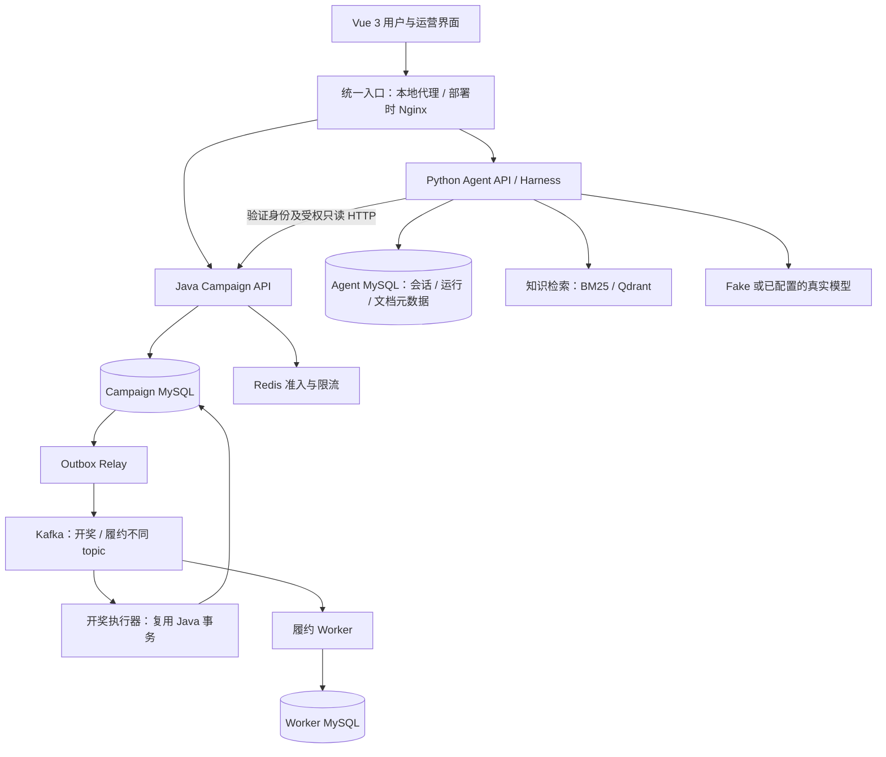

# PrizeFlux 产品与 Python Agent 架构方案

2026-09-28 增强设计附录：[双项目竞争力增强方案](competitiveness-enhancement-plan.md)。它在本架构上细化 Creator 报告合同、真实 RAG/效果评测及 Java 容量实验；现有安全/事务边界继续有效。下方原阶段状态是历史记录，当前完成度以 `PROJECT_STATUS.md` 顶部为准。

日期：2026-09-26；2026-09-27 P11a 续记。状态：P4～P8 已完成 Python Harness、Campaign 受权只读工具、持久会话/运行 API、事件/SSE、取消/租约恢复、owner 删除与默认 30 天留存清理；P9/P10 索引构建与 hybrid retrieval/ACL/revocation 内核有自动化验证；P11a 已将 retrieval 接入 Harness，完成无证据拒答、完成前 evidence 复核、Run 引用 metadata API 与 Vue 来源清单。检索默认关闭；尚无真实 Embedding/Qdrant 配置或 active index。运营助手 Vue 页已接入 Python session/run API。本机 Campaign↔Python↔Vue 真实进程联调、长任务 token 过期策略、离线/真实评测、真实 provider、性能/发布验收尚未完成；不能视为完整上线。本文是 Python 主线及当前排队增强的目标设计；旧 Java Harness 记录保留为迁移基线。能力索引见 [Python 能力地图](../../CAPABILITY-MAP-AGENT-PYTHON.md)，交付计划见 [product-delivery-plan.md](product-delivery-plan.md)。

## 1. 产品目标与成功标准

定位为面向小型活动组织者、社群管理员和平台运营者的活动发布与抽奖平台，配套一个有业务权限、有知识来源、能够解释建议的活动助手。用户创建活动、获得检查建议、提交运营审核；参与者查看规则并即时或排队抽奖；运营者处理审核和异常。首版提供模拟奖品履约，不涉及支付、真实商品交易或付费抽奖。

产品价值假设：减少组织者配置规则的错误和重复咨询，帮助运营者更快理解草案与驳回原因，高峰时让参与者获得明确的受理/结果状态。先用用户任务完成率、草案问题检出率、报告可用性和故障恢复证据验证；没有真实客户数据前不编造节省人力、商业收入或生产访问量。

三个首发 AI 工作流：

| 用户任务 | 输入与工具 | 产品交付物 |
|---|---|---|
| 创建者：提交前检查活动 | 当前草案/版本、Java 确定性校验工具、规则检索 | 阻断项、建议项、对应字段、依据、需要用户确认的修改 |
| 创建者：理解驳回与修改方向 | 本人活动、真实审核理由、规则片段 | 带来源的修改建议；不推断审核员未记录的动机 |
| 用户/运营：理解规则与活动状态 | 公开或本人/运营可见的活动查询、角色匹配知识库 | 规则说明、实时事实及查询时间、可点开的依据 |

运营异常诊断作为后续增强：只在 Java 提供受权的聚合队列/履约状态 API 后接入。首版不让模型查询内部监控系统、任意 SQL 或他人参与明细。

## 2. 选型与取舍

| 部分 | 目标选型 | 原因与限制 |
|---|---|---|
| 业务后端 | 保留 Java 17 / Spring Boot 3.5 / MyBatis / MySQL / Flyway | 已有事务、身份与审核行为可复用 |
| 消峰与事件 | Redis 限流 + MySQL 受理事实 + Outbox + Kafka | 消息投递至少一次；最终幂等与库存正确性在 MySQL |
| Agent 服务 | Python 3.12、FastAPI、Pydantic、httpx、uv 锁文件 | 独立构建/部署；异步 HTTP 与严格输入输出合同 |
| 控制流 | LangGraph StateGraph + 项目自己的 Harness 策略层 | 图只管理运行步骤；权限、预算、工具与业务语义由项目实现 |
| Agent 持久化 | SQLAlchemy / Alembic，独立 `prizeflux_agent` MySQL schema 与独立账号 | 复用 MySQL 运行底座；账号无 Campaign/Worker 表权限 |
| Agent Redis 用途 | 首版不作为对话记忆库 | 后续可用于限流、热点上下文缓存或跨实例提示；MySQL 保留权威会话和运行事件 |
| 知识检索 | BM25 基线 + Qdrant dense 向量 + RRF 融合 | 先对比实测；Qdrant 仅 AI knowledge profile 启动 |
| Embedding | 独立 EmbeddingPort；已实现无默认启用的 OpenAI-compatible adapter；本地 BGE 中文小模型仍为待评估候选 | 与生成模型解耦；部署方必须提供真实固定模型 revision/维度；核查许可并测资源/延迟。当前未下载权重、未调用外部服务 |
| 用户界面 | 保留 Vue 3，增加报告/引用/运行状态组件 | 同一产品入口；前端不放供应商密钥 |
| 可观测与质量 | request/run ID、结构化日志、业务指标、pytest 评测集 | 无需依赖收费托管追踪平台；禁止记录密钥和模型隐式推理 |

实现时在锁文件固定实际兼容版本并记录许可证；这里没有安装依赖或调用供应商。首版采用一个图运行时，避免同时引入 DeepAgents、smolagents、OpenHands 多套循环。LangGraph 的持久化检查点不是本方案首版运行恢复承诺：会话/运行事实由独立 RunStore 保存，进程中断按第 6 节处理。

## 3. 运行边界

Java 的接口线程不转发整段模型生成流。沿用现有 AI 服务的身份委托方式：浏览器请求 Python，Python 向固定 Campaign `/api/auth/me` 验证 Bearer token，再按同一用户身份调用固定只读业务 API。此前“Vue → Java 鉴权 → Python”的口头图表示逻辑信任顺序；具体网络拓扑采用本节，避免模型延迟占据抽奖 API 的工作线程。

- Python 不持有 Java JWT 签名密钥、不接受客户端/模型声明的角色；Bearer 只存在当前请求/运行内存，不能落 RunStore、日志或模型上下文。
- 身份服务不可用则拒绝受保护运行；会话/结果/SSE 重连也重新验权，不能只凭 sessionId/runId 读取。
- Campaign 自己继续执行角色与 owner 授权；Python 的工具可见性只是额外约束，不替代后端校验。
- 出站业务客户端仅允许配置的 Campaign origin 和固定路径，禁止模型提供 URL、重定向与任意 HTTP。生产跨主机使用 TLS；本机回环与明确隔离的 Compose 网络在部署规格中单独配置。
- 每次工具读取重新由 Java 验证 token；账号角色变化、token 过期时终止运行并返回安全错误。
- Agent 资源池/连接池独立；AI 关闭、知识索引失败、供应商超时不能破坏登录/活动/抽奖。

## 4. Java 高峰链路的收口方案

队列收口实现已落在 `DrawQueueApplicationService`、`JdbcDrawQueueRepository`、`DrawQueueKafkaConsumer` 与 Web，采用以下合同：

1. **受理与完成分开。** USER 通过认证/限流及基础活动检查后，在事务内写 `draw_queue_request` 和 Outbox，提交后返回 202。202 表示已持久化受理；不承诺中奖、预占库存或严格排队名次。消费者执行时重新检查活动、时间、配额与库存；关闭/结束前已受理但尚未通过权威检查的请求可以被拒绝，页面要说明此规则。
2. **跨模式幂等。** 原 DRAW/QUEUED_DRAW 是不同操作域。前端对一次动作锁定模式和 requestKey，超时查询原请求；不能自动从排队切换即时重新抽。两模式共用同一 MySQL 业务配额；模式切换属于新的用户动作，并受配额约束。
3. **消费可恢复。** 给队列补执行租约、领取 token、尝试次数、下次执行时间与心跳/过期判断。扫描器重投到期任务或补齐已提交结果。明确业务拒绝才进入 REJECTED；数据库暂态失败进入有界重试；异常用尽进入人工处理状态，保存脱敏原因。
4. **最终结果优先。** 先查开奖幂等结果，再决定重试/拒绝。处理“开奖事务已提交、队列完成更新前崩溃”的窗口；旧执行者不能覆盖新租约结果。终态更新用 CAS/fencing token；库存/次数/结果/中奖 Outbox 仍由原开奖事务保证。
5. **Kafka 丢通知可恢复。** 消息只携带任务 ID；消费者从 MySQL 加载可信内容。通知重复、消费重平衡和重投不重复开奖。配置明确的 ACK、错误处理和死信策略，死信记录与 DB 任务状态关联；DB 扫描负责业务最终可见性。
6. **避免单活动单分区瓶颈。** 当前 publisher 用 campaignId 作 key，同一热门活动集中一分区。目标改为稳定 queueRequestId 或活动内固定 shard key；单活动可分散处理。取消全局 FIFO 承诺，仍以 MySQL 事务防超卖。独立 draw-executor 运行配置复用 Campaign 应用/基础设施代码，多实例使用同一个 consumer group。
7. **受控准入。** Redis 原子限流覆盖用户、活动和全局容量；MySQL 写入发生在准入后。积压高水位、最老任务年龄、DB 连接池压力触发拒绝新请求，留恢复余量。积压监测存在采样延迟，不能称硬性精确队列容量。Redis 故障沿用失败关闭；状态查询单独限流且不能被提交流量挤占。
8. **如实验证吞吐。** Kafka 能缓冲执行峰值，但每次受理仍要写 MySQL，热点库存行仍会串行竞争。先测单活动/多活动与不同库存分布；只有确认瓶颈及业务收益后再考虑 Redis 库存预占，不把预占和补偿协议硬塞进本轮。

实现验证记录（2026-09-26）：Campaign/Contract 全量模块测试 198 项通过；最终增补后的开奖应用集成测试 10 项及 Kafka consumer/DLT 集成测试 2 项另行通过；Web 13 个文件/32 项测试与生产构建通过。测试覆盖租约/fencing、最终开奖结果恢复、活动关闭后的拒绝、消费者成功和毒消息隔离。当前证据不包含本机完整服务 smoke、Broker 停机恢复/rebalance、并发压测或生产容量；这些仍待实测。

这是高峰随机抽奖方案。传统商品秒杀的先到先得、订单支付、库存预约/超时释放属于另一套合同，当前不把它写进已实现亮点。

## 5. Harness 控制循环与工具合同

运行图：鉴权/归属确认 → 占有会话运行 → 构造受限上下文 → 模型选择工具或结束 → 工具策略校验 → 执行并记录观察 → 回到模型 → 校验最终报告 → 持久化终态。每个节点有可测试的 Python 端口；LangGraph 类型只在编排适配层使用。

首版工具表：

| 工具 | 输入 | 服务端限制 |
|---|---|---|
| `campaign.read` | campaignId | 依据登录角色调用公开/本人/运营查询；不扩张现有 API 权限 |
| `campaign.draft.validate` | 结构化草案或本人草案引用 | 只读 Java 确定性校验，返回字段问题；模型不能更改概率规则 |
| `campaign.review.read` | campaignId | 本人审核理由或 OPERATOR 查询；字段最小化 |
| `knowledge.search` | query、可选主题 | scope 来自 Actor，模型不能传 role/ownerId/accessLevel |

正常问答使用真实模型结构化 tool calling，由 Harness 在允许集合内接受选择；不支持该合同的供应商明确报不支持，不能假装已具备 Agent 工具能力。Fake 使用脚本覆盖同一合同。模型输出严格 schema 校验、未知字段拒绝、调用结果限长，限制相同失败调用的循环次数。提示注入防线落在工具/身份/数据边界；模型的“我有权限”不构成授权。

候选默认预算：每 run 最多 6 次模型调用、8 次工具调用、60 秒总时限、每次输出最多 2,000 tokens、工具结果最多 16 KiB。具体值在首个真实模型实验后调优；配置保存到运行记录中。上下文按完整轮次裁剪，保留工具调用与结果配对，摘要明确标为摘要。供应商 tokenizer 未知时估算只用于预警，不能宣称精确 token 上限；请求 max_tokens、步数和总时限做强制约束。

最终报告采用 schema：`summary`、`findings[{severity,field,message,evidenceRefs}]`、`suggestions`、`sources`、`dataAsOf`。业务阻断项来自 Java 校验；模型新增项标为建议。来源引用必须属于本次已授权取得的 evidence 集合；引用存在不代表语义必然正确，需评测其支持性。无依据时说明缺失信息。

报告中的建议由用户查看后在现有编辑页显式保存；保存前 Java 再验权/校验，并校对草案 revision 或配置指纹，过期建议要求重新检查。Python 不提供保存、审核、发布或开奖工具。

## 6. 会话、幂等、费用和失败恢复

Agent 自己管理 `agent_session`、`agent_run`、`agent_event`、`agent_artifact`、`knowledge_document`/`knowledge_chunk` 与索引版本记录。结构化事件保存输入/输出摘要与工具事实；用户可见会话正文按 owner 隔离保存。凭据、隐藏推理、未脱敏供应商响应不入库。初始留存 30 天，可配置并提供用户删除/后台清理策略；审计字段遵循最小必要原则。

P8 当前实现包含 Campaign Bearer 身份委托、owner-scoped session/history/run/cancel/status HTTP、有限并发 worker、LangGraph 模型/工具 await 期间的持久取消检查、状态事件与 SSE `Last-Event-ID` replay，以及 lifespan 周期租约回收。状态事件按 run 行锁递增 sequence 并与状态变更同事务提交；当前 payload 为空，不记录 prompt 或模型文本。运行中取消先持久化请求并停止续租，过期租约转为 INTERRUPTED，不自动重发调用。MySQL 8.4 Testcontainers 验证了跨请求 owner 隔离、SSE 续读不重调模型及在途取消。

P8 后续收口了隐私删除与保留：`DELETE /api/ai/v2/sessions/{id}` 对空闲会话立即级联删除；若有活动 run，先立刻隐藏会话与 run 读取、持久请求取消并返回 202，执行器确认取消后再物理删除会话及级联历史/事件。后台默认每小时检查，按 `updated_at` 保留 30 天；对已标记删除的 ACCEPTED run 做安全取消和清理。对应 Alembic `20260927_04`，MySQL 8.4 集成测试覆盖 owner 隔离、级联删除、运行中删除、保留与 accepted 清理。

P8 当前支持 owner-scoped `POST /api/ai/v2/runs/{id}/resume`：只有 `ACCEPTED` 才由显式用户操作重新 dispatch 同一个 run；其它状态 409，数据库 claim/fencing 防止重复执行。服务端不保存用户 Bearer，也不自动领取已受理的任务。长时间 SSE 每 15 秒复核令牌，但运行中的模型/工具执行在 token 过期时的端到端策略尚未联调；工具事实/报告事件、Campaign/Python 真实多进程 smoke 也未实现。当前是本地集成切片，不是可公网部署的完整 Agent。

### 多轮会话记忆

Agent 需要记住同一会话前面几轮的内容，但不需要 Redis 才能做到。首版由 Agent 自有 MySQL schema 保存会话事件，按 `sessionId + ownerId + sequence` 读取；提交新一轮时用 session version 做并发控制。Redis 速度快，但这里模型生成通常是主要耗时，先把会话复制一份到 Redis 会多出双写、淘汰和删除一致性问题。

每次模型调用都从持久历史构造一个有界上下文：最近若干完整轮次、最近一次相关检查报告和草案版本、必要的压缩摘要、当前问题。模型不接收无限聊天记录；旧轮次按留存策略保存在 MySQL，但不必每次都送进上下文。摘要作为模型生成的辅助记忆标注，规则和活动当前状态仍分别从知识库和 Java 授权接口重新读取。

这里分三种“记忆”：同一聊天的短期上下文由 MySQL 会话事件支持；RAG 用来找平台规则和操作文档；跨会话的用户长期画像首版不做。LangGraph 文档把单线程短期状态与跨线程 Store 分开，本方案保留这个概念，但首版不启用长期 Store，也不额外复制图检查点作为第二份用户会话。[LangGraph persistence](https://docs.langchain.com/oss/python/langgraph/persistence)

Redis 后续可以作为可重建的热点上下文缓存、限流器或跨实例事件提示。缓存键包含 owner、session version、摘要版本；未命中回源 MySQL，Redis 故障不能丢历史。Redis 支持 RDB/AOF，也能做 session store，但持久性取决于配置并带来恢复和资源权衡；它适合明确选择的 session/cache 场景，不是多轮对话的必选项。[Redis persistence](https://redis.io/docs/latest/operate/oss_and_stack/management/persistence/) [Redis session-store](https://redis.io/docs/latest/develop/use-cases/session-store/)

Python Agent API 通过 Vite `/agent-api` 代理公开（剥离前缀转发到 8083）：

| API | 合同 |
|---|---|
| `POST /api/ai/v2/sessions` | 已认证用户创建自己的会话；返回服务端 ID |
| `POST /api/ai/v2/sessions/{id}/runs` | `clientMessageId + expectedVersion + input`；受理后 202/runId |
| `GET /api/ai/v2/runs/{id}` | 本人状态/报告/安全错误码 |
| `POST /api/ai/v2/runs/{id}/resume` | 显式恢复本人仍处于 ACCEPTED 的同一 run；其它状态 409，不产生新 run |
| `GET /api/ai/v2/runs/{id}/events` | 已认证流式事件；按 event sequence 重放，不重新调用模型 |
| `POST /api/ai/v2/runs/{id}/cancel` | 幂等取消，本人请求；停止后续工具/模型调用 |
| `GET /api/ai/v2/sessions/{id}` | 本人会话状态与历史；owner filter 从 server-side Actor 得到 |
| `DELETE /api/ai/v2/sessions/{id}` | 本人删除；空闲会话返回 204 并级联删除，活动 run 返回 202、先隐藏数据并取消，执行结束后硬删除 |

- 幂等唯一键为 `(session_id, client_message_id)`，指纹包含输入与 expectedVersion。同键同指纹返回原 run；异参 409。跨用户/不存在同样返回 404。
- 提交时在短事务内校验 owner/version、占有 `active_run_id` 并写运行记录；一个会话最多一个 active run。避免旧 Java 流程在 CAS 提交失败前已经重复调用付费模型的窗口。不同会话再受全局/用户并发限制。
- 不在数据库事务里等模型。后台调度使用有界运行槽，run 有 lease/heartbeat/fencing token；进程间占有以 MySQL 为准，Redis 只做准入辅助。
- 状态：ACCEPTED → RUNNING → COMPLETED / FAILED / CANCELLED / INTERRUPTED。崩溃后租约扫描把无有效执行者的 run 标为 INTERRUPTED，保留已落盘会话/事件。首版不跨进程保存 Bearer，也不自动继续付费模型步骤。
- 用户重新登录后可基于旧运行创建新的 retry run；保留 parentRunId，重新验权并刷新业务事实。属于新的调用，UI 说明可能新增费用。SSE 重连仅读原 run，断流不自动重发 prompt。
- 模型请求超时/断网可能已经计费；此类调用标为 usage unknown。默认不自动重试真实生成请求；不能宣称“付费 exactly-once”。只读工具暂态错误允许有限重试，并受剩余总预算约束。
- cost budget 记录供应商返回的 usage 与配置价格版本；缺 usage 或未知价格只展示估算/未知。调用前按输出预算保守预留，仍不承诺供应商账单绝对不超限；真实 provider 在初次联调前由用户确认额度。
- SSE 使用可带认证头的流式 fetch；事件只含进度、工具名称/安全摘要、引用与最终报告。刷新页面读取 run 状态；不向用户展示模型隐藏思考。

## 7. RAG 的必要范围

首版语料只导入项目自己维护的 Markdown/TXT 平台帮助、审核规则、概率/库存语义和运营操作手册。没有任意 URL 抓取、用户任意上传、PDF/OCR 或私人活动资料导入；这些能力需要独立的访问/删除合同。

离线导入管道：授权来源清单 → 文档哈希/版本 → 按标题与段落切片 → 保存来源/section/访问级别 → Embedding → 写新版本 Qdrant collection 与 BM25 snapshot → 样本校验 → 原子更新 active index version。失败保持旧版本可读；保留上一版本用于回滚。切片 ID 可由 docId/version/section/offset 推导，重导相同内容幂等。

初始检索参数作为实验起点：切片约 300–600 tokens，少量重叠；BM25 与 dense 各取 top 20，以 RRF 融合后取 top 5。中文 BM25 分词、数值/活动词精确匹配需固定处理方式；记录 embedding 模型及 revision、向量维度、chunker/tokenizer 版本。不在没有评测收益前加 reranker 或 GraphRAG。

访问范围由服务端身份决定：USER 只检索公开帮助；OPERATOR 可检索公开帮助与运营手册。两路召回都先按 scope 和 active version 过滤，合并后再用权威文档元数据复核有效性，再交给模型。文档撤回立即更新权威状态；索引清理可异步，但撤回内容不得再进入输出。缓存 key 包含 scope/indexVersion/模型版本，禁止跨角色复用最终答案。

MySQL 元数据与向量索引不存在跨库原子事务，采用版本化构建、切换指针和失败回滚；元数据检查失败时关闭检索。小语料 BM25 snapshot 可以进程内加载但需要可恢复磁盘产物、内容哈希和所有实例同版本约束。向量模型由应用启动加载一次、有界批量导入；CPU 密集工作不占 FastAPI 事件循环。

真实检索可以使用本地 Embedding 独立于真实生成模型验证。Fake embedding 只能做管道测试，不能计入召回质量。没有相关资料、无权限、索引不可用和模型不可用使用不同内部原因与用户提示；不把无检索结果包装成可靠回答。

## 8. Vue 产品体验

- 创建页提供“提交前检查”入口，报告分字段问题、建议、依据；跳转定位表单字段。模型没有改动表单的隐式权限。
- 规则问答放在活动详情和帮助入口，回答区显示引用与事实查询时间；Creator/Operator 看到各自可用能力。
- 运行过程展示“读取活动 / 检索规则 / 整理建议”，提供停止按钮和中断恢复提示；不展示内部堆栈或伪造思考过程。
- 排队页区分“已受理 / 处理中 / 已出结果 / 处理异常”；停止轮询不等于取消开奖。不显示未经队列系统承诺的名次和等待倒计时。
- 运营台优先显示待审核、处理中与需人工处理的业务事项；延迟、积压等工程指标放诊断视图。
- 保持移动端、键盘操作、明确焦点、错误就地提示与 reduced-motion；Fake 演示在助手区域显示可见标记。

## 9. 迁移与部署

建议目录：`backend/` 保留 Java；`agent-service/src/prizeflux_agent/{api,application,domain,infrastructure}`；`agent-service/tests/{unit,contract,integration}`；`agent-service/evals/`；`agent-service/knowledge/`；共用 `web/`、`deploy/` 与 `docs/`。Python domain 不导入 FastAPI/数据库/模型 SDK；图节点调用 application 端口。

迁移顺序：先记录 Java AI HTTP/角色/owner/错误合同（见 [java-agent-baseline.md](java-agent-baseline.md)）→ Python 在单独端口 8083 对照运行 → 新 v2 页面通过配置选择 Python → 新会话使用 Python → 验收后再评估 Java AI 停用。原 8082 继续可回退；现有进程内 Java 会话不迁移，切换前提示开启新会话，不假装保留历史。回退前停止接受 Python 新 run 并等待/取消活动 run，旧 Python 历史保留供后续恢复，不能给 Java 读取 Python 表。

`local-full` 分别运行 Campaign、draw-executor、fulfillment-worker、Python Agent 与基础设施；`agent-knowledge` profile 才启动向量/Embedding。前期可以同机部署、进程分别限资源；业务 API 和 AI 不共用应用线程池。Python 替代 Java AI 后，旧 cloud-demo 把 AI JAR 合并到同 JVM 的设计不再适用，改为独立 Python 容器。公网部署另需用户的环境选择；本轮不部署服务器。

Agent 有单独最小权限 DB 用户、迁移历史和备份；业务数据库保持现有 schema 所有权。健康检查区分进程存活与依赖就绪；供应商不可用不阻止 Java 就绪。依赖版本、镜像、模型文件 revision 在发布前固定。公开演示用合成数据/演示账号，配置 TLS、允许来源、登录/注册防滥用、Secret 注入与备份恢复后再开放。

## 10. 借鉴来源与自主工程内容

2026-09-26 核对以下官方来源。Star 数会变化，不作为安全或适用性证明；实施前固定实际采用版本/commit 并记录引用/许可证。

| 来源 | 借鉴点 | 本项目决定 |
|---|---|---|
| [LangGraph](https://github.com/langchain-ai/langgraph) / [持久化](https://docs.langchain.com/oss/python/langgraph/persistence) | 有状态图、控制流与检查点概念 | 采用图运行时；首版不宣称跨进程自动续跑 |
| [DeepAgents](https://github.com/langchain-ai/deepagents) | Harness 与运行时分层、上下文及 middleware 思路 | 参考设计；首版不引入其完整文件系统/子 Agent 能力 |
| [OpenHands SDK](https://github.com/OpenHands/software-agent-sdk) | 模型/工具/会话职责分离、结构化运行记录 | 参考事件和接口设计；不提供编码代理权限 |
| [smolagents](https://github.com/huggingface/smolagents) | 小型工具循环、模型适配与工具合同 | 参考易测试接口；不安装任意代码执行工具 |
| [RAGFlow](https://github.com/infiniflow/ragflow) | 文档导入、检索与引用工作流 | 借鉴流程，只实现本产品所需文本知识库 |
| [Qdrant filtering](https://qdrant.tech/documentation/search/filtering/) | 检索时的 payload 条件 | 用于角色/版本过滤，同时复核权威元数据 |
| [BGE 中文小模型](https://huggingface.co/BAAI/bge-small-zh-v1.5) | 中文检索 Embedding 候选 | 实测资源和召回后锁版本；不混同于生成模型 API |

简历中的自主工程内容是权限与数据边界、幂等运行、恢复语义、预算控制、证据引用、评测及产品接入。使用 LangGraph 时如实写“基于 LangGraph 构建 Harness”，不声称自研底层图运行时。若复用源码需先核对许可并保留必要声明，不能改名冒充原创。

## 11. 架构复核结论

本方案最需要守住的五处：Kafka 消峰后的 MySQL 写入瓶颈；重复消费与提交结果未知的恢复；会话并发提前占有以避免重复付费；RAG 权限/索引版本一致性；旧 Java AI 向 Python 的合同与回退。它们都进入实施计划的验收关口。

暂缓多 Agent、通用工具平台、微调、GraphRAG、Kubernetes 和 Redis 库存预占。项目竞争力通过完整用户工作流、核心不变量、失败恢复和可复现实测建立。架构文件只能说明设计，不能替代已实现能力或用户本人掌握程度。
